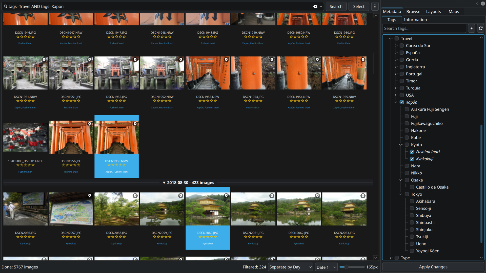
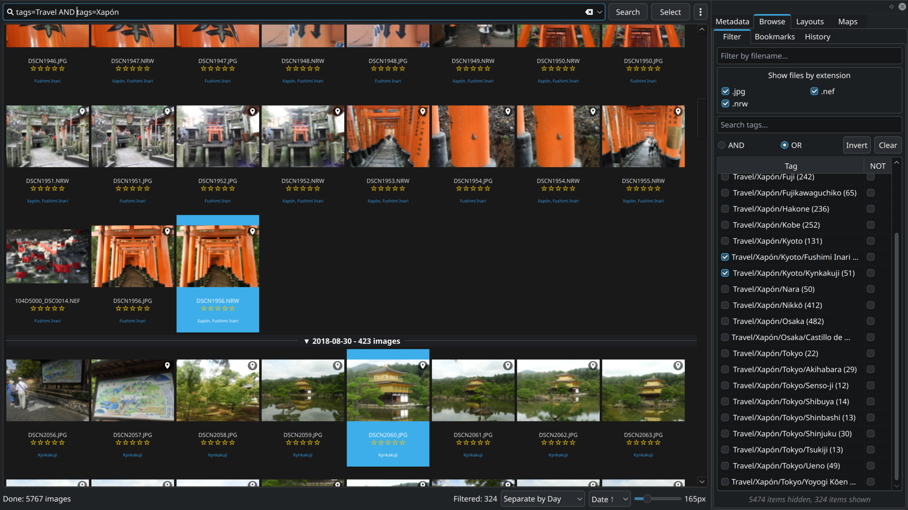
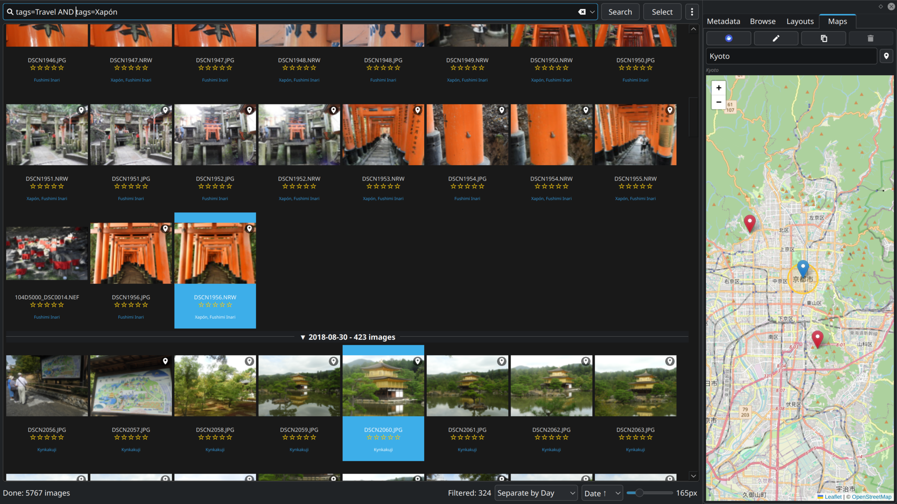

# Manual de usuario de Bagheera Image Viewer

## 1. Introducción

¡Bienvenido a Bagheera Image Viewer! Esta aplicación está diseñada para ayudarte a explorar, organizar y gestionar tu colección de imágenes de forma ágil y eficiente, destacando por su integración nativa con Baloo (el servicio de indexación de archivos de KDE). Bagheera ofrece una cuadrícula de miniaturas virtualizada, filtros avanzados, detección de duplicados y un completo visor de imágenes integrado.

### Características principales:

* **Cuadrícula de miniaturas**: Navega por grandes colecciones de imágenes mediante una vista fluida y de alto rendimiento.
* **Filtros avanzados**: Filtra imágenes por nombre de archivo, extensión y etiquetas (incluyendo estructuras jerárquicas).
* **Integración con Baloo**: Aprovecha la indexación de Baloo para gestionar etiquetas y metadatos al instante.
* **Detección de duplicados**: Localiza y gestiona imágenes repetidas utilizando distintos algoritmos de comparación.
* **Diseños de interfaz personalizados**: Guarda y recupera la disposición de tus ventanas y paneles.
* **Visor de imágenes avanzado**: Entorno dedicado con herramientas de navegación, zoom, presentación de diapositivas y edición básica de imágenes.
* **Detección de regiones**: Identifica y etiqueta automáticamente rostros y mascotas. También permite añadir regiones personalizadas de forma manual (cuerpos, objetos, puntos de interés, etc.).
* **Reconocimiento de personas**: Reconoce a personas en tus fotografías mediante vectores de reconocimiento facial (*embeddings*) y ofrece herramientas sencillas para etiquetar rostros.
* **Atajos de teclado**: Atajos completamente configurables para agilizar tu flujo de trabajo.
* **Supervisión del sistema de archivos**: Actualiza la vista de miniaturas automáticamente cuando se añaden, modifican o eliminan archivos de forma externa.

## 2. Descripción general de la interfaz principal

La ventana principal de Bagheera Image Viewer se divide en las siguientes áreas:

### 2.1. Barra de búsqueda

Ubicada en la parte superior, te permite:

* **Realizar búsquedas**: Introduce palabras clave, etiquetas (por ejemplo, `tags=landscape`) o sintaxis específica de Bagheera.
* **Navegar por rutas**: Escribe directamente la ruta de una carpeta para escanearla o de un archivo para abrirlo en el visor.
* **Botón Explorar**: Abre el selector de archivos del sistema para elegir una imagen o directorio.

### 2.2. Cuadrícula de miniaturas

El espacio central muestra tus imágenes como miniaturas. Esta vista está virtualizada, lo que permite manejar miles de archivos sin resentir la fluidez de la aplicación.

* **Selección de elementos**: Haz clic en una miniatura para seleccionarla. Utiliza `Ctrl+Clic` para seleccionar múltiples imágenes o `Mayús+Clic` para seleccionar un rango continuo.
* **Doble clic**: Al hacer doble clic en una miniatura, esta se abre a tamaño completo en el visor dedicado.
* **Navegación por carpetas**: Si estableces el valor de `Nivel máximo de escaneo` en `0` dentro de los Ajustes, la búsqueda en modo **Plana** (*Flat*) mostrará los subdirectorios inmediatos junto a las imágenes de la carpeta actual (sin escanear el contenido interno de dichas subcarpetas). La opción de carpeta superior permite subir de nivel en el árbol de directorios. Los elementos de tipo directorio no se ven afectados por los filtros de imagen y se ocultan cuando se activa cualquier modo de agrupación. Haz doble clic o pulsa `Intro` sobre una carpeta para abrirla dentro del mismo flujo de búsqueda.
* **Miniaturas de archivos RAW**: Si el archivo RAW contiene una vista previa JPEG integrada, Bagheera la utiliza para generar la miniatura rápidamente antes de decodificar el archivo RAW completo.
* **Menú contextual**: Haz clic con el botón derecho sobre una miniatura o sobre el encabezado de un grupo para desplegar un menú de acciones rápidas (ver Sección 5).

### 2.3. Barra de estado

Situada en el borde inferior de la ventana, informa sobre la actividad de la aplicación:

* **Estado actual**: Muestra mensajes informativos como "Listo", "Cargando...", "Hecho" o avisos de error.
* **Barra de progreso**: Muestra la evolución de tareas en segundo plano, como el escaneo de imágenes o la búsqueda de duplicados.
* **Indicador de supervisión de archivos**: Un pequeño icono de carpeta indica si el sistema está monitoreando activamente los cambios en el disco.
* **Contador de elementos filtrados**: Muestra el número de imágenes visibles tras aplicar los filtros de búsqueda.

### 2.4. Barra de controles inferiores

Junto a la barra de estado se encuentran los siguientes controles para gestionar la cuadrícula:

* **Cargar más imágenes**: (Visible cuando hay más resultados) Carga el siguiente bloque de imágenes del escaneo en curso.
* **Cargar todas las imágenes**: (Visible cuando hay más resultados) Carga de forma continua todo el contenido restante del escaneo.
* **Cancelar duplicados**: (Visible durante el análisis de duplicados) Detiene la búsqueda de coincidencias.
* **Modo de vista (Desplegable)**: Cambia la agrupación de las miniaturas en la cuadrícula:
  * **Plana**: Sin grupos; muestra todas las imágenes en una lista continua.
  * **Separar por carpeta**: Agrupa las imágenes según la carpeta en la que están guardadas.
  * **Separar por Día/Semana/Mes/Año**: Agrupa las imágenes por su fecha de modificación.
  * **Separar por valoración**: Agrupa las imágenes según su puntuación por estrellas.
* **Ordenación (Desplegable)**: Define el criterio de ordenación:
  * **Nombre ↑ / Nombre ↓**: Ordena alfabéticamente por nombre de archivo (ascendente o descendente).
  * **Fecha ↑ / Fecha ↓**: Ordena por fecha de modificación (de más antiguas a más recientes o viceversa). En las vistas agrupadas por fecha, **Fecha ↑** muestra los grupos en orden cronológico ascendente; el resto de opciones sitúa los grupos más recientes al principio.
* **Deslizador de tamaño**: Cambia la escala visual de las miniaturas.
* **Indicador de tamaño**: Muestra la dimensión actual de las miniaturas en píxeles.

## 3. Paneles laterales (Docks)

La aplicación incluye un panel lateral acoplable (oculto por defecto) que da acceso a herramientas avanzadas. Puedes activar o desactivar su visibilidad desde el menú principal o mediante atajos de teclado.

Las pestañas del panel lateral se organizan en: **Metadatos** (Etiquetas, Información), **Explorar** (Filtro, Marcadores, Historial), **Diseños** (exclusivo de X11) y **Mapas**. Sus atajos de acceso directo son: `Ctrl+Shift+T` (Etiquetas), `Ctrl+Shift+I` (Información), `Ctrl+Shift+F` (Filtro), `Ctrl+Shift+B` (Marcadores), `Ctrl+Shift+H` (Historial), `Ctrl+Shift+L` (Diseños) y `Ctrl+Shift+M` (Mapas).

### 3.1. Pestaña Metadatos

Contiene las secciones **Etiquetas** e **Información**.

#### Etiquetas

Permite consultar y modificar las etiquetas asignadas a las imágenes seleccionadas.



* **Resumen visual**: En la captura superior se aprecia la pestaña **Etiquetas** dentro del panel lateral de **Metadatos**. Tras aplicar el filtro `tags=Travel AND tags=Xapón` en la cuadrícula principal, se han seleccionado varias imágenes. En el árbol de la derecha se muestra la jerarquía de etiquetas (`Travel > Xapón > Kyoto`). Las casillas marcadas indican etiquetas asignadas; cuando una etiqueta solo está presente en algunas de las imágenes seleccionadas, se muestra en *texto en cursiva* (como *Fushimi Inari* o *Kynkakuji*). Al hacer clic en "Aplicar cambios", se guardan los cambios pendientes.

* **Árbol de etiquetas**: Estructura jerárquica con el catálogo de etiquetas.
  * **⭐ ETIQUETAS USADAS**: Muestra las etiquetas asociadas a las imágenes seleccionadas.
  * **📂 TODAS LAS ETIQUETAS**: Muestra las etiquetas indexadas por Baloo,
    filtrables mediante las expresiones regulares de Ajustes > Etiquetas >
    Etiquetas visibles. Si se oculta una etiqueta padre, también se ocultan sus
    descendientes.
* **Buscador de etiquetas**: Filtra las etiquetas disponibles en el árbol.
* **Añadir etiqueta (`+`)**: Abre un cuadro de diálogo para crear una nueva etiqueta. Puedes crear estructuras jerárquicas usando la barra diagonal (por ejemplo, `Naturaleza/Animales`).
* **Actualizar etiquetas**: Recarga la lista de etiquetas desde la base de datos de Baloo.
* **Aplicar cambios**: Guarda en el archivo las modificaciones de etiquetas realizadas.
* **Ctrl+Clic en una casilla**: Fuerza el cambio del estado de una casilla, permitiendo marcar o desmarcar una etiqueta aunque los archivos seleccionados tengan estados mixtos.
* **Menú contextual de etiqueta**: Al hacer clic derecho sobre una etiqueta del árbol se ofrecen las siguientes opciones:
  * **Buscar por esta etiqueta**: Inicia una búsqueda filtrando por dicha etiqueta.
  * **Añadir a la búsqueda con AND**: Añade la etiqueta a la búsqueda activa exigiendo que se cumpla junto a los criterios actuales.
  * **Añadir a la búsqueda con OR**: Añade la etiqueta a la búsqueda activa como alternativa opcional.
* **Códigos de formato e indicación visual**:
  * *Texto en cursiva*: Indica una asignación parcial (la etiqueta no está presente en todos los archivos seleccionados).
  * Texto en azul: Indica que la etiqueta se ha modificado localmente pero los cambios aún no se han guardado en el archivo.

#### Información

Permite consultar y editar los datos generales de las imágenes seleccionadas.

* **Valoración**: Asigna una puntuación de 0 a 5 estrellas. Haz clic en las estrellas para cambiar el estado (Sin valoración -> Completa -> Media -> Sin valoración).
* **Comentario**: Campo de texto para añadir o editar observaciones.
* **Aplicar cambios**: Guarda la valoración o los comentarios modificados. El botón solo se muestra cuando hay cambios pendientes.

### 3.2. Pestaña Explorar

Agrupa las pestañas **Filtro**, **Marcadores** e **Historial**.

#### Filtro

Permite acotar los resultados mostrados en la cuadrícula de miniaturas.



* **Resumen visual**: La imagen muestra la sección **Filtro** dentro del panel **Explorar**. En la parte superior es posible activar o desactivar formatos específicos (`.jpg`, `.nef`, `.nrw`). En la lista inferior se han seleccionado etiquetas concretas (`Travel/Xapón/Kyoto/Fushimi Inari` y `Travel/Xapón/Kyoto/Kynkakuji`), lo que reduce la vista central a 324 imágenes de un total de 5.767, como confirma la barra de estado ("5474 elementos ocultos, 324 elementos mostrados").

* **Filtrar por nombre de archivo**: Campo para buscar archivos por texto (no distingue entre mayúsculas y minúsculas).
* **Filtrar por extensión**: Muestra las extensiones detectadas durante el escaneo. Puedes desmarcar formatos para ocultarlos de la vista.
* **Buscador de etiquetas**: Filtra el listado de etiquetas de la parte inferior.
* **Modo de combinación de etiquetas (AND/OR)**:
  * **AND**: Muestra únicamente las imágenes que contengan **todas** las etiquetas seleccionadas.
  * **OR**: Muestra las imágenes que contengan **al menos una** de las etiquetas seleccionadas.
  * Los filtros de nombre, extensión y etiqueta actúan de forma acumulativa (una imagen debe cumplir todos los criterios activos para mostrarse).
* **Invertir**: Invierte la selección de las casillas de etiquetas.
* **Limpiar**: Restablece los filtros de etiquetas y vuelve a activar todas las extensiones.
* **Estadísticas del filtro**: Muestra cuántas imágenes quedan ocultas por los filtros activos.
* **Tabla de etiquetas**: Listado con las etiquetas detectadas en la colección.
  * **Columna Etiqueta**: Marca la casilla para incluir imágenes con esta etiqueta.
  * **Columna NOT**: Marca la casilla para **excluir** imágenes que tengan esta etiqueta (activar una casilla desmarca automáticamente la opuesta).

#### Marcadores

Permite guardar y administrar búsquedas frecuentes.

* **Buscador**: Filtra la lista de marcadores guardados.
* **Tabla de marcadores**: Muestra tus búsquedas guardadas junto con su descripción, la sintaxis utilizada y su atajo de teclado asignado.
* **Cargar**: Ejecuta la búsqueda del marcador seleccionado.
* **Añadir**: Guarda la búsqueda actual de la barra superior como un nuevo marcador (solicita un comentario descriptivo).
* **Renombrar**: Modifica el comentario del marcador seleccionado.
* **Atajo**: Asigna una combinación de teclas rápida para activar el marcador.
* **Eliminar**: Borra el marcador seleccionado.
* **Subir / Bajar**: Reordena la posición de los marcadores en la lista.

#### Historial

Guarda un registro de las búsquedas y carpetas abiertas recientemente.

* **Tabla de historial**: Muestra el historial con las consultas ejecutadas y la fecha de acceso.
* **Doble clic**: Vuelve a ejecutar la búsqueda del historial seleccionada.
* **Borrar todo**: Vacía el historial por completo.
* **Eliminar seleccionado**: Elimina el registro seleccionado.
* **Eliminar anteriores**: Elimina la entrada seleccionada y todos los registros más antiguos.

### 3.3. Pestaña Diseños (exclusivo de X11)

Permite guardar y restaurar la posición y tamaño de la ventana principal y de las ventanas secundarias del visor. Esta opción solo está disponible en sistemas bajo X11, ya que Wayland no permite posicionar ventanas mediante código por motivos de seguridad.

* **Tabla de diseños**: Lista los diseños guardados con su nombre y fecha de edición.
* **Cargar**: Aplica la disposición de ventanas seleccionada.
* **Crear**: Guarda la disposición de ventanas actual con un nuevo nombre.
* **Guardar**: Actualiza el diseño seleccionado con la disposición de ventanas actual.
* **Renombrar**: Cambia el nombre del diseño seleccionado.
* **Copiar**: Duplica el diseño seleccionado con otro nombre.
* **Eliminar**: Elimina el archivo del diseño.

### 3.4. Pestaña Mapas

Muestra en un mapa interactivo la ubicación GPS de las imágenes seleccionadas. Requiere QtWebEngine y conexión a Internet.



* **Resumen visual**: En la imagen se observa la pestaña **Mapas** en funcionamiento. Al buscar "Kinkakuji" en la barra del mapa, este se centra en las coordenadas encontradas mostrando un marcador azul. Las marcas rojas indican la posición geográfica de las fotos seleccionadas en la cuadrícula central.

* **Campo de búsqueda de mapas**: Acepta coordenadas decimales (`38.199083, 128.466750`), coordenadas sexagesimales DMS (`38°11'56.7"N 128°28'00.3"E`), códigos Google Plus Code o nombres de lugares (mediante la API de Nominatim). Pulsa `Intro` o el botón de la lupa para buscar.
* **Marcador de resultado**: Las búsquedas añaden un marcador temporal en el mapa. Haz clic sobre él para eliminarlo. Si la edición de ubicación no está activa, hacer clic en cualquier punto del mapa creará también un marcador temporal.
* **Abrir en Google Maps**: Abre la ubicación en la web de Google Maps. Si las imágenes seleccionadas tienen coordenadas distintas, se mostrará un diálogo para elegir cuál abrir.
* **Asignar / editar ubicación**: Permite asignar la ubicación marcada en el mapa a todas las imágenes seleccionadas mediante un clic.
* **Copiar ubicación**: Copia la posición de una imagen o marcador temporal hacia otras imágenes seleccionadas (pudiendo elegir si aplicar los cambios a todas o solo a las fotos sin coordenadas GPS).
* **Borrar ubicación GPS**: Elimina los datos de geolocalización de la foto seleccionada.

Si existe un marcador temporal, se puede utilizar como origen para copiar coordenadas. Al buscar una ubicación, el mapa se reencuadra a un radio aproximado de 1 km (únicamente si la vista actual era más amplia, evitando alejar el zoom si ya estabas más cerca).

## 4. Visor de imágenes

El visor se abre en una ventana independiente al hacer doble clic sobre cualquier miniatura o al abrir una imagen directamente.

### 4.1. Navegación

* **Imagen anterior / siguiente**: Utiliza las teclas de dirección, la rueda del ratón o los botones en pantalla para desplazarte por la lista de imágenes.
* **Primera / Última imagen**: Salta directamente al inicio o al final del catálogo actual.

### 4.2. Zoom

* **Acercar / Alejar**: Utiliza los atajos `+` / `-`, la rueda del ratón junto con la tecla `Ctrl`, o las opciones del menú.
* **Restablecer zoom**: Ajusta la imagen al 100% de su tamaño real o la encuadra en la pantalla.

### 4.3. Pantalla completa

Activa el modo a pantalla completa para visualizar las imágenes sin elementos de interfaz que distraigan.

### 4.4. Presentación de diapositivas

* **Iniciar / Detener presentación**: Avanza automáticamente por las imágenes según el intervalo configurado.
* **Presentación en orden inverso**: Reproduce la secuencia de imágenes hacia atrás.
* **Configurar intervalo**: Ajusta el tiempo de permanencia de cada imagen en pantalla.

### 4.5. Tira de miniaturas (Filmstrip)

Panel flotante con miniaturas situadas en el borde inferior, superior o lateral del visor que muestra las fotos contiguas.

* **Mostrar / Ocultar tira**: Activa o desactiva la visibilidad de la franja.
* **Posición**: Define su ubicación desde el menú de Ajustes.

### 4.6. Detección de regiones

Permite identificar y marcar áreas de interés dentro de la fotografía.

* **Detectar rostros y mascotas**: Analiza la imagen y detecta caras o animales automáticamente.
* **Añadir región manualmente**: Permite delimitar y etiquetar áreas concretas (rostros, mascotas, cuerpos, objetos o puntos de interés).
* **Mostrar / Ocultar regiones**: Muestra u oculta los rectángulos delimitadores de las regiones detectadas.
* **Renombrar región**: Cambia la etiqueta asignada a una región.
* **Eliminar región**: Borra una marca de región.

### 4.7. Edición y manipulación

* **Rotar a la izquierda / derecha**: Gira la orientación visual de la imagen 90° (sin modificar los píxeles del archivo en disco).
* **Volteado horizontal / vertical**: Invierte la imagen en su eje horizontal o vertical.
* **Modo recorte**: Permite seleccionar una zona para recortar la imagen. Mantén pulsada la tecla `Mayús` mientras arrastras con el ratón para conservar la relación de aspecto.
* **Guardar recorte**: Guarda el área seleccionada como una nueva imagen independiente.

### 4.8. Operaciones con archivos

* **Renombrar**: Cambia el nombre del archivo de la imagen actual.
* **Mover a la papelera**: Envía el archivo a la papelera de reciclaje del sistema.
* **Eliminar permanentemente**: Elimina el archivo del disco de forma definitiva.
* **Copiar imagen**: Copia la imagen al portapapeles del sistema.
* **Copiar ruta**: Copia la ruta absoluta del archivo en el portapapeles.
* **Abrir con otra aplicación**: Despliega un menú para abrir la imagen con un programa externo.

### 4.9. Diálogo de propiedades

Muestra una ventana detallada con la información del archivo, metadatos y etiquetas EXIF, permitiendo además editar atributos extendidos (*xattr*).

## 5. Menús contextuales

### 5.1. Menú contextual de miniaturas (Clic derecho sobre una miniatura)

* **Ver**: Abre la imagen en el visor dedicado.
* **Submenú Selección**:
  * **Seleccionar todo**: Selecciona todas las miniaturas visibles.
  * **Deseleccionar todo**: Limpia la selección actual.
  * **Invertir selección**: Invierte los elementos seleccionados.
* **Submenú Abrir**:
  * **Abrir a pantalla completa**: Abre la imagen en el visor a pantalla completa.
  * **Abrir y buscar ubicación**: Escanea la carpeta contenedora y la establece como la búsqueda activa.
  * **Abrir ubicación en el gestor de archivos**: Abre la carpeta de la imagen en el explorador de archivos predeterminado del sistema.
  * **Abrir con otra aplicación...**: Muestra las aplicaciones compatibles con el tipo de archivo.
* **Renombrar...**: Permite cambiar el nombre del archivo.
* **Mover a...**: Traslada la imagen a otra carpeta.
* **Copiar a...**: Duplica la imagen en otra ubicación.
* **Submenú Rotar**:
  * **Izquierda**: Gira la imagen 90° en sentido contrario a las agujas del reloj.
  * **Derecha**: Gira la imagen 90° en el sentido de las agujas del reloj.
* **Mover a la papelera**: Envía el archivo a la papelera.
* **Eliminar**: Borra el archivo de forma permanente.
* **Submenú Portapapeles**:
  * **Copiar imagen al portapapeles**: Copia el contenido de la imagen.
  * **Copiar ruta del archivo**: Copia la ruta del archivo.
  * **Copiar ruta de la carpeta**: Copia la ruta de la carpeta contenedora.
* **Regenerar miniatura**: Fuerza la recreación de la miniatura de la imagen.
* **Propiedades**: Abre el panel de información y metadatos.

### 5.2. Menú contextual de grupo (Clic derecho sobre el encabezado de un grupo)

* **Contraer / Expandir grupo**: Muestra u oculta las miniaturas pertenecientes a ese grupo.

## 6. Menú principal

Se accede mediante el icono de menú (tres puntos o barras horizontales) situado en la barra de herramientas superior.

### 6.1. Gestión de caché

* **Borrar caché**: Elimina todas las miniaturas guardadas en memoria RAM y en el disco duro. Esta acción no se puede deshacer.
* **Mantenimiento de caché**: Elimina miniaturas huérfanas de archivos que han sido borrados o movidos fuera de la aplicación.

### 6.2. Detección de duplicados

*(Requiere que la librería `imagehash` esté instalada en el sistema)*

* **Detectar en la búsqueda actual**: Analiza únicamente las imágenes visibles en la cuadrícula en ese momento.
* **Forzar análisis completo de la búsqueda**: Recalcula todas las huellas digitales de las imágenes visibles, ignorando los datos guardados en caché.
* **Detectar en todo**: Escanea las carpetas incluidas en la lista blanca de Ajustes en busca de duplicados (omitirá las carpetas de la lista negra).
* **Forzar análisis completo de todo**: Recalcula las huellas de todas las carpetas de la lista blanca.
* **Revisar ignorados**: Abre una ventana para gestionar las parejas de duplicados marcadas previamente como "ignoradas".
* **Mantenimiento de huellas**: Elimina registros antiguos de la base de datos de duplicados y reconstruye el árbol de búsqueda interno (*BK-Tree*).
* **Borrar base de datos de huellas**: Elimina por completo los datos de análisis de duplicados guardados. Esta acción no se puede deshacer.

### 6.2.1. Gestor de duplicados

Cuando se abre la ventana de resolución de duplicados, la interfaz ofrece dos modos de comparación:

* **Lado a lado** (*Side by Side*): Muestra las dos imágenes en paneles paralelos con zoom y desplazamiento sincronizados si el botón **Vincular paneles** está activo (se puede alternar con la tecla `L`).
* **Superposición** (*Overlay*): Muestra ambas imágenes integradas en la misma vista mediante 4 sub-modos:
  * **Alternar** (*Toggle*): Muestra una imagen a la vez; pulsa `Tab` o haz doble clic para alternar entre ellas.
  * **Dividir** (*Split*): Un separador vertical arrastrable permite revelar una imagen a cada lado.
  * **Diferencia** (*Difference*): Resalta en tiempo real la diferencia de píxeles entre ambas tomas.
  * **Opacidad** (*Opacity*): Un deslizador controla la transparencia de la capa superior (0-100%).

Controles en el modo superposición:
* **Rueda del ratón / Arrastrar**: Desplaza ambas imágenes al mismo tiempo.
* **Mayús + Rueda / Arrastrar**: Desplaza solo la imagen superior.
* **Ctrl + Rueda / Arrastrar**: Desplaza solo la imagen inferior.
* **Doble clic**: Alterna entre ajustar a la ventana y ver a tamaño real (escala 1:1).
* **Tecla Z**: Restablece la vista (vuelve a centrar la barra divisoria o ajusta la opacidad al 50%).
* **Tecla S**: Intercambia la posición de las dos capas (superior/inferior).

Barra de acciones inferior:
* **Enviar izquierda/derecha a la papelera** (`U` / `I`): Envía la imagen del panel correspondiente a la papelera.
* **Sobrescribir** (`W`): Sustituye un archivo por el otro renombrándolo (pide confirmación previa mostrando ambas rutas).
* **Conservar ambas** (`O`) y **Omitir** (`P`): Dan por resuelta la pareja de imágenes actual y avanzan a la siguiente.

Las etiquetas de resolución y tamaño muestran en distinto color cuál de los dos archivos ofrece mejor calidad en cada apartado.

### 6.3. Ajustes

Abre el panel de configuración general (ver Sección 7).

### 6.4. Idioma

Permite cambiar el idioma de la aplicación. Requiere reiniciar Bagheera para aplicar los cambios de forma completa.

### 6.5. Acerca de

Muestra la versión de la aplicación y la información del autor.

## 7. Configuración y Ajustes

El cuadro de diálogo de Ajustes permite personalizar el funcionamiento de la aplicación:

### 7.1. Escáner

* **Nivel máximo de escaneo**: Profundidad máxima de subcarpetas que se explorarán al escanear de forma recursiva.
* **Tamaño del lote de escaneo**: Cantidad de imágenes que se procesan por cada bloque durante la lectura de directorios.
* **Escaneo completo al iniciar**: Inicia automáticamente la lectura de todas las imágenes al abrir la aplicación.
* **Hilos de generación**: Número máximo de núcleos de procesador dedicados simultáneamente a crear miniaturas.
* **Motor de búsqueda de archivos**: Permite elegir entre el motor interno de Bagheera (`BagheeraSearch`) o el motor del sistema (`baloosearch`).

### 7.2. Etiquetas

La subpestaña **Etiquetas rápidas** configura las etiquetas usadas recientemente.
En **Etiquetas visibles**, introduce expresiones regulares (una por línea) para
filtrar el árbol de **TODAS LAS ETIQUETAS**:

* Una lista blanca vacía incluye todas las etiquetas; si contiene expresiones,
  cada etiqueta debe coincidir con al menos una.
* Las coincidencias de la lista negra se excluyen. Una lista negra vacía no
  excluye ninguna etiqueta.
* Las expresiones se comparan con la ruta jerárquica completa. Si se oculta una
  etiqueta padre, también se ocultan sus descendientes.
* **ETIQUETAS USADAS** siempre muestra todas las etiquetas asignadas a las
  imágenes seleccionadas, sin aplicar estos filtros.

### 7.3. Regiones

Configuración para la detección de rostros, mascotas, cuerpos u objetos:

* **Etiquetas de [Tipo de Región]**: Etiquetas asignadas por defecto al detectar una región (por ejemplo, `Person` para rostros).
* **Motor de detección**: Librería utilizada para procesar la imagen (por ejemplo, MediaPipe para detección facial).
* **Color del cuadro**: Color del marco con el que se resaltan las regiones detectadas.
* **Historial de nombres**: Número de nombres recientes guardados en el autocompletado.
* **Usar último nombre por defecto**: Rellena el cuadro de nombre automáticamente con la última etiqueta utilizada.
* **Restablecer a 'Rostro' tras asignar**: Vuelve al modo predeterminado de selección de rostros tras haber añadido manualmente otro tipo de región (mascota, objeto, etc.).
* **Descargar modelo**: Botón para descargar los modelos de IA necesarios para MediaPipe.

### 7.4. Miniaturas

* **Tiempo de refresco (ms)**: Pausa de espera antes de redibujar las miniaturas al cambiar la escala.
* **Color de fondo de la cuadrícula**: Color del tapiz sobre el que se muestran las miniaturas.
* **Color de texto**: Colores personalizados para los nombres de archivo, etiquetas e indicadores de puntuación.
* **Tamaño de letra**: Tamaño de la tipografía del texto bajo las miniaturas.
* **Líneas de texto**: Ajusta cuántas líneas de texto se permiten para mostrar el nombre del archivo y las etiquetas.
* **Estilo de globos informativos**: Personalización del fondo y color de texto de los mensajes flotantes (*tooltips*).
* **Elementos visibles**: Casillas para activar u ocultar la valoración, el nombre o las etiquetas bajo cada miniatura.

### 7.5. Visor de imágenes

* **Velocidad del zoom con la rueda**: Sensibilidad del desplazamiento con el ratón al hacer zoom.
* **Ajustar ventana al hacer zoom**: Redimensiona la ventana de la aplicación de forma automática para amoldarse a la escala de la imagen.
* **Posición de la tira de miniaturas**: Define la ubicación por defecto del panel flotante de miniaturas (Inferior, Izquierda, Superior o Derecha).

### 7.6. Duplicados

* **Algoritmo de análisis**: Permite elegir entre **Histograma + Hashes** o **ResNet (Basado en IA)**. *(ResNet requiere librerías adicionales de IA)*.
* **Umbral de similitud por Hash**: Ajusta la tolerancia del análisis de duplicados (del 50% al 100%). Cuanto más alto sea el porcentaje, más idénticas deberán ser las imágenes.
* **Similitud mediante IA**: Activa la comparación visual basada en modelos de IA (MediaPipe/FAISS).
* **Umbral de similitud IA**: Tolerancia del modelo de inteligencia artificial (del 70% al 100%).
* **Confirmar borrado**: Pide confirmación antes de enviar un archivo duplicado a la papelera.
* **Lista blanca**: Directorios incluidos en los análisis globales de duplicados.
* **Lista negra**: Directorios omitidos en el análisis.
* **Enviar a la papelera por defecto**: Define si la tecla `Supr` mueve las fotos a la papelera o las elimina definitivamente del disco duro.

## 8. Atajos de teclado

Puedes consultar y editar los atajos de teclado de la aplicación desde el menú principal (`Menú > Configurar atajos de teclado...`).

Los atajos están divididos en dos categorías: **Globales** (afectan a la ventana principal) y **Visor** (afectan al visor de imágenes).

### 8.1. Personalizar atajos

1. Haz doble clic sobre la acción que desees modificar.
2. Pulsa la nueva combinación de teclas en tu teclado.
3. Si la combinación entra en conflicto con otra función, se mostrará un aviso que te permitirá reasignarla o cancelar.

## 9. Uso desde la línea de comandos

Bagheera Image Viewer se puede iniciar directamente desde la consola pasando parámetros de ruta o búsqueda:

```bash
bagheeraview [file:/ruta_al_archivo | file:/directorio | search:/consulta]
bagheeraview --x11 [file:/ruta_al_archivo | file:/directorio | search:/consulta] # Fuerza el servidor X11 (necesario para guardar diseños)
bagheeraview --resolution 1920x1080 [file:/ruta_al_archivo | file:/directorio | search:/consulta] # Establece una resolución de ventana fija
```